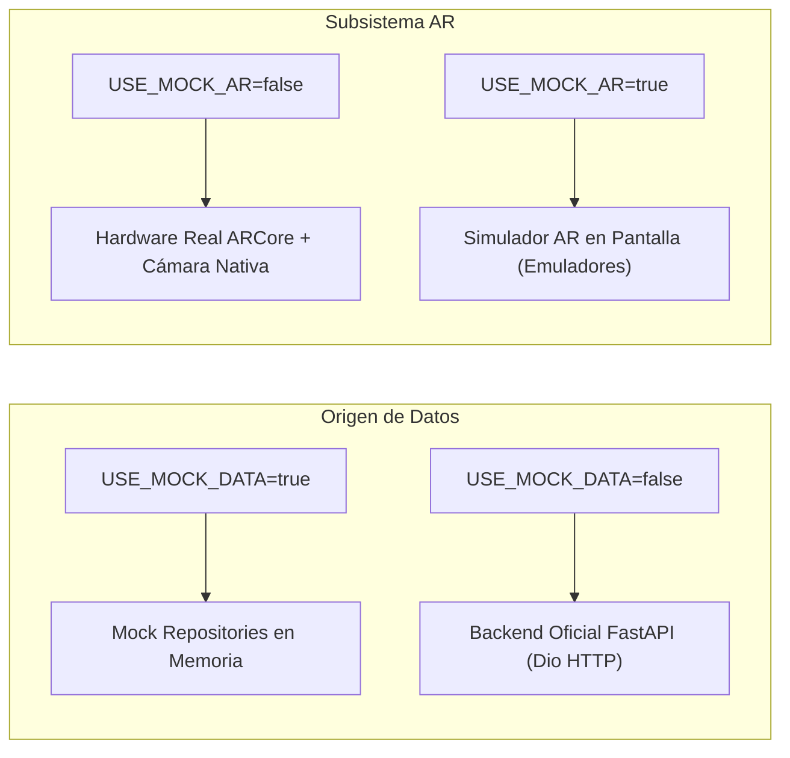

# 🌟 Tale Star Mobile

> **Aplicación móvil oficial del ecosistema Tale Star**  
> Experiencias creativas para niños y familias: cuentos generativos ilustrados, lector inmersivo en **Realidad Aumentada (ARCore)**, reproductor de audio de alta fidelidad (**FLAC Lossless**) y entorno seguro de consumo protegido con **Modo Niño por PIN parental**.

---


-success)


---

## 📑 Tabla de Contenidos

1. [Visión General del Producto](#1-visión-general-del-producto)
2. [Pila Tecnológica y Entorno Verificado](#2-pila-tecnológica-y-entorno-verificado)
3. [Arquitectura del Software (Feature-First Clean Architecture)](#3-arquitectura-del-software-feature-first-clean-architecture)
4. [Estructura Detallada de Carpetas](#4-estructura-detallada-de-carpetas)
5. [Módulos y Funcionalidades Principales](#5-módulos-y-funcionalidades-principales)
6. [Desacoplamiento Arquitectónico (USE_MOCK_DATA vs USE_MOCK_AR)](#6-desacoplamiento-arquitectónico-use_mock_data-vs-use_mock_ar)
7. [Catálogo de Dependencias Justificadas](#7-catálogo-de-dependencias-justificadas)
8. [Configuración de Ambientes y Variables de Entorno](#8-configuración-de-ambientes-y-variables-de-entorno)
9. [Guía de Instalación y Ejecución](#9-guía-de-instalación-y-ejecución)
10. [Aseguramiento de Calidad (QA) y Pruebas Automatizadas](#10-aseguramiento-de-calidad-qa-y-pruebas-automatizadas)
11. [Consideraciones de Seguridad y Protección de Datos](#11-consideraciones-de-seguridad-y-protección-de-datos)

---

## 1. Visión General del Producto

**Tale Star Mobile** es la interfaz cliente móvil del universo Tale Star, diseñada pensando en la dualidad de usuarios:
1. **Adultos (Padres, Madres y Educadores):** Administran la biblioteca de creaciones, gestionan el perfil, configuran los temas visuales, consultan información de suscripciones y habilitan el entorno protegido de lectura mediante un **PIN parental de 4 dígitos**.
2. **Niños:** Consumen cuentos e ilustraciones en un entorno inmersivo, accesible y seguro, sin riesgos de compras no deseadas, fugas de navegación ni accesos a configuraciones de cuenta.

### Principales Diferenciadores
- **Lector AR Tridimensional Inmersivo:** Proyección física de cuentos infantiles sobre superficies reales (mesas o suelo) mediante integración nativa con Google ARCore y OpenGL ES 2.0 (inspirado en la referencia de diseño *MU-09 Mobile AR Story Reader*).
- **Modo Niño Indestructible (Secure by Default):** Confinamiento estricto en rutas protegidas mediante interceptores en `GoRouter`, intercepción gestual con `PopScope` y resistencia ante reinicios o desconexión de red.
- **Reproductor Musical Flotante:** Audio en segundo plano con soporte para streaming FLAC y un mini-reproductor interactivo persistente sobre la barra de navegación.
- **Accesibilidad Integral:** Áreas de toque $\ge 48 \times 48\text{ dp}$, soporte semántico para lectores de pantalla TalkBack, y protección ante desbordamientos por escalado de texto gigante (`textScaler.clamp`).

---

## 2. Pila Tecnológica y Entorno Verificado

| Componente | Versión / Especificación | Notas Técnicas |
|---|---|---|
| **Framework** | **Flutter 3.41.9** (channel stable) | Motor de renderizado multiplataforma. |
| **Runtime** | **Dart 3.11.5** | Tipado estático y nulabilidad estricta (*sound null safety*). |
| **Plataforma MVP** | **Android** (minSdk 24, targetSdk 35/36) | Java 17, AGP 8.7.0, Gradle 8.11.1. |
| **Hardware de Validación** | **Xiaomi Redmi Note 15 Pro 5G** | Modelo `25080RABDG`, Android 16 / API 36, certificado Google ARCore. |
| **Subsistema AR** | **Google ARCore 1.47.0** (`com.google.ar:core`) | Vista nativa en Kotlin con shader OpenGL ES 2.0 y PlatformView. |
| **Gestión de Estado** | **BLoC / Cubit** (`flutter_bloc: ^9.0.0`) | Flujos unidireccionales predecibles e inmutables. |
| **Inyección de Dependencias** | **GetIt 8.3.0** | Service Locator para inversión de control y pruebas desacopladas. |
| **Enrutamiento** | **GoRouter 14.8.1** | Enrutamiento declarativo con guards y redirecciones reactivas. |
| **Almacenamiento Seguro** | **Flutter Secure Storage 9.2.4** | Cifrado a nivel de hardware con Android KeyStore. |

---

## 3. Arquitectura del Software (Feature-First Clean Architecture)

El proyecto implementa una arquitectura limpia organizada por características (**Feature-First Clean Architecture**), desacoplando totalmente las reglas de negocio de la interfaz gráfica y de las fuentes de datos externas.

```
┌─────────────────────────────────────────────────────────────┐
│                     PRESENTATION LAYER                      │
│        (Screens, Widgets, BLoC / Cubits, ViewStates)         │
└──────────────────────────────┬──────────────────────────────┘
                               │  depende de
                               ▼
┌─────────────────────────────────────────────────────────────┐
│                        DOMAIN LAYER                         │
│     (Entities, Repository Contracts, Use Cases, Failures)    │
│            *Código Dart Puro, Cero Dependencias de UI*       │
└──────────────────────────────▲──────────────────────────────┘
                               │  implementa
                               │
┌──────────────────────────────┴──────────────────────────────┐
│                         DATA LAYER                          │
│     (DTO Models, DataSources, Repository Implementations)   │
│             (Dio, Secure Storage, Shared Preferences)       │
└─────────────────────────────────────────────────────────────┘
```

### Reglas de Dependencia
1. **Cero Dependencias hacia afuera:** La capa `domain` es autónoma; no importa widgets, BLoCs ni clientes HTTP.
2. **Contratos Inmutables:** Los repositorios se definen como interfaces abstractas en `domain/repositories/` y se implementan en `data/repositories/`.
3. **Manejo de Errores con Either / Failures:** Todas las operaciones de red y persistencia capturan excepciones tipadas (`ServerException`, `NetworkException`, `UnauthorizedException`) y las transforman en fallos de dominio (`ServerFailure`, `NetworkFailure`, `AuthFailure`).

---

## 4. Estructura Detallada de Carpetas

```
StarTale_mobile/
├── android/                        # Proyecto nativo Android
│   ├── app/
│   │   ├── src/main/kotlin/...     # Implementación Kotlin de ARCore
│   │   │   └── com/startale/startale_mobile/
│   │   │       ├── MainActivity.kt                # Host de PlatformView y ciclo de vida
│   │   │       ├── ArCorePlatformView.kt          # Motor OpenGL ES, tracking y matrices
│   │   │       ├── ArCorePlatformViewFactory.kt   # Factoría de vistas nativas para Flutter
│   │   │       └── BackgroundRenderer.kt          # Shaders GLSL de cámara con corrección UV
│   │   └── build.gradle.kts        # Configuración de compilación, minSdk 24 y ARCore
│   ├── build.gradle.kts            # Configuración de plugins de Gradle
│   └── settings.gradle.kts         # Repositorios y resolución de artefactos
├── assets/                         # Recursos estáticos de la aplicación
│   └── demo/                       # Ilustraciones y pistas de audio para modo Mock
│       ├── demo_song.wav           # Pista de audio FLAC/WAV para validación local
│       ├── demo_forest.png         # Ilustración "Bosque Encantado"
│       ├── demo_castle.png         # Ilustración "Castillo de las Estrellas"
│       └── demo_space.png          # Ilustración "Galaxia de los Sueños"
├── docs/                           # Documentación técnica y de aseguramiento de calidad
│   └── implementation-plan.md      # Plan maestro de arquitectura e implementación v3.0
├── environments/                   # Variables de entorno declaradas (desacopladas)
│   ├── .env.development            # Configuración para desarrollo local
│   ├── .env.staging                # Configuración para pruebas remotas
│   └── .env.production             # Configuración para despliegue final
├── lib/                            # Código fuente Flutter de la aplicación
│   ├── core/                       # Núcleo compartido transversal (cross-cutting concerns)
│   │   ├── config/                 # AppConfig y resolución de variables de entorno
│   │   ├── constants/              # Dimensiones, duraciones y cadenas del sistema
│   │   ├── error/                  # Definición de Failures y Exceptions tipadas
│   │   ├── network/                # Cliente Dio con interceptores JWT y timeouts
│   │   ├── router/                 # Configuración de GoRouter, rutas y guards
│   │   ├── storage/                # SecureStorage, Preferences y AuthenticatedCacheManager
│   │   └── theme/                  # Paleta de colores, tipografía Inter y temas claro/oscuro
│   ├── features/                   # Módulos funcionales del negocio (Feature-First)
│   │   ├── augmented_reality/      # Subsistema de Realidad Aumentada (ARCore PlatformView)
│   │   │   ├── domain/             # Entidades AR y contrato de sensor/tracking
│   │   │   ├── data/               # Fuentes de telemetría y repositorios AR
│   │   │   └── presentation/       # ArCubit, ArStoryViewerScreen, ArReticle, ArStoryCard3d
│   │   ├── authentication/         # Autenticación, registro e identidad
│   │   │   ├── domain/             # UserEntity y AuthRepository
│   │   │   ├── data/               # UserModel, AuthRemoteDataSource y AuthRepositoryImpl
│   │   │   └── presentation/       # AuthCubit, LoginScreen, RegisterScreen, ForgotPassword
│   │   ├── child_mode/             # Modo protegido y seguridad parental por PIN
│   │   │   ├── domain/             # ParentalPinRepository y validaciones
│   │   │   ├── data/               # ParentalPinRemoteDataSource con DTOs OpenAPI
│   │   │   └── presentation/       # ChildModeCubit, PinSetupScreen, PinValidationDialog, PinKeypad
│   │   ├── library/                # Catálogo de creaciones (cuentos, música, imágenes)
│   │   │   ├── domain/             # LibraryItemEntity y LibraryRepository
│   │   │   ├── data/               # LibraryItemModel y LibraryRemoteDataSource
│   │   │   └── presentation/       # LibraryCubit, LibraryScreen, LibraryItemCard
│   │   ├── music/                  # Reproducción musical y streaming FLAC Lossless
│   │   │   ├── domain/             # MusicTrackEntity y MusicPlayerRepository
│   │   │   ├── data/               # JustAudioPlayerService y MusicRepositoryImpl
│   │   │   └── presentation/       # MusicPlayerCubit, MusicPlayerScreen, PersistentMiniPlayer
│   │   ├── profile/                # Perfil de usuario, preferencias y suscripciones
│   │   │   ├── presentation/       # ProfileCubit, ProfileTabScreen, ThemeSelectionSheet, PlansSheet
│   │   └── reader/                 # Lector tradicional 2D de cuentos
│   │       ├── domain/             # StoryEntity, StoryPageEntity y ReaderRepository
│   │       ├── data/               # StoryModel, PageModel y ReaderRemoteDataSource
│   │       └── presentation/       # ReaderCubit, StoryReaderScreen, ReaderControlBar
│   ├── mock/                       # Repositorios simulados en memoria para desarrollo autónomo
│   │   ├── mock_auth_repository.dart
│   │   ├── mock_library_repository.dart
│   │   ├── mock_reader_repository.dart
│   │   ├── mock_music_repository.dart
│   │   └── mock_parental_pin_repository.dart
│   ├── shared/                     # Componentes visuales y utilidades reutilizables
│   │   ├── utils/                  # Formateadores de fecha, validadores y helpers
│   │   └── widgets/                # TsButton, TsCard, TsTextField, TsPinField, TsEmptyState, etc.
│   ├── app.dart                    # MaterialApp.router con inyección de tema y textScaler clamp
│   ├── injection_container.dart    # Configuración de GetIt con alternancia dinámico Mock/Real
│   └── main.dart                   # Punto de entrada de la aplicación móvil
├── test/                           # Suite de pruebas automatizadas
│   ├── unit/                       # Pruebas unitarias de dominio, datasources, DTOs y cubits
│   └── widget/                     # Pruebas de widgets, interacción, navegación y accesibilidad
├── analysis_options.yaml           # Reglas de análisis estático (flutter_lints)
├── pubspec.yaml                    # Especificación de paquetes, dependencias y assets
└── pubspec.lock                    # Fijación determinista de versiones para CI/CD
```

---

## 5. Módulos y Funcionalidades Principales

### 🔐 1. Autenticación y Gestión de Sesión
- Soporte para inicio de sesión (`POST /api/v1/auth/login`) y registro con PIN opcional (`POST /api/v1/auth/register`).
- Almacenamiento seguro del token Bearer JWT mediante `flutter_secure_storage`.
- Restauración reactiva de sesión al abrir la aplicación (`restoreSession`).
- **Cierre de sesión en cascada:** Purga simultánea del reproductor musical, sesión AR, caché de cuentos, modo niño y tokens criptográficos en el dispositivo.

### 📚 2. Biblioteca Multimedia
- Exploración de creaciones con chips de filtrado dinámico: **Todos**, **Historias**, **Imágenes** y **Música**.
- Búsqueda en tiempo real por texto (`q`) con indicador de carga y estados vacíos amigables en español.
- Marcado y desmarcado instantáneo de favoritos con actualización optimista en UI.
- Soporte para refresco manual por gesto (*pull-to-refresh*).

### 📖 3. Lector Tradicional 2D
- Navegación fluida de página en página con transición suave y barra de control inferior (`ReaderControlBar`).
- Visualización de ilustraciones en alta resolución con placeholders y manejo de errores de red.
- Contenedor narrativo scrolleable que previene desbordamientos y se adapta a la tipografía del sistema.
- Acceso directo para activar el **Modo Niño** o alternar al **Lector AR**.

### 🥽 4. Lector de Realidad Aumentada (ARCore)
- **Renderizado Nativo:** Integración con la cámara trasera en orientación vertical estricta mediante OpenGL ES 2.0 (`BackgroundRenderer.kt`).
- **Detección Continua:** Soporte para planos horizontales e *Instant Placement*, permitiendo detectar suelos y mesas en segundos.
- **Retícula Espacial 3D:** Indicador visual que refleja el estado de tracking (`Buscando superficie`, `Superficie detectada`, `Punto listo`).
- **Tarjeta 3D Anclada (`ArStoryCard3d`):** El cuento se proyecta en el espacio físico como una hoja/libro tridimensional con sombra de oclusión ambiental y perspectiva real.
- **Narrativa sin Truncado:** Scroll vertical independiente para textos largos de cuentos sin puntos suspensivos (`...`).
- **Interacción Espacial:** Soporte de gestos para rotar la tarjeta sobre su eje (yaw) y pellizcar para escalar su tamaño (zoom).
- **Salida Segura y Redundante:** Botón "X" en la cabecera superior libre de interferencias táctiles y botón inferior "Salir de AR".

### 🎵 5. Reproductor Musical FLAC Lossless
- Motor de audio basado en `just_audio` con carátula de disco vinilo giratorio y barra de tiempo interactiva.
- Marcado de calidad de audio Lossless y controles de salto ($\pm 10\text{ s}$).
- **Mini-reproductor Flotante (`PersistentMiniPlayer`):** Se mantiene visible en la parte inferior de la pantalla mientras el adulto navega por la biblioteca o el perfil, ocultándose automáticamente en Modo Niño.

### 🛡️ 6. Modo Niño y Seguridad Parental por PIN
- Creación y actualización de PIN de 4 dígitos (`PUT /api/v1/auth/parental-pin`) con validación contra el backend o hash seguro local.
- **Confinamiento Absoluto:** Redirección automática en `GoRouter` si se intenta navegar a rutas fuera del contenido autorizado.
- **Intercepción de Salida (`PopScope`):** El botón o gesto de "Atrás" de Android queda bloqueado exigiendo el PIN parental en un teclado modal táctil accesible (`PinKeypad`).
- **Protección contra Fuerza Bruta:** Bloqueo temporal con temporizador de enfriamiento de 30 segundos tras 3 intentos erróneos consecutivos.
- **Resistencia ante Fallos:** Si se pierde la conexión a internet, el Modo Niño permanece activo y bloqueado por seguridad (*Secure by Default*).

### 👤 7. Perfil, Apariencia y Suscripciones
- Información del usuario con avatar generado dinámicamente según sus iniciales.
- **Sistema de Temas Dinámicos:** Selector modal con opciones de **Tema Claro**, **Tema Oscuro** o **Predeterminado del Sistema**, con reactividad inmediata.
- **Catálogo Informativo de Planes:** Consulta referencial de los tres planes oficiales (**Plan Go** USD 10/mes, **Plan Plus** USD 20/mes y **Plan Pro** USD 100/mes), con aviso explícito y transparente de que la facturación se gestiona exclusivamente en la plataforma web de Tale Star.

---

## 6. Desacoplamiento Arquitectónico (USE_MOCK_DATA vs USE_MOCK_AR)

Para permitir el desarrollo autónomo en hardware real sin depender del despliegue del backend FastAPI en la nube, la aplicación cuenta con un esquema de doble bandera independiente:



### Modos Operativos Recomendados

1. **Pruebas en Hardware Físico (Recomendado para validación de AR y UI):**
   ```powershell
   --dart-define=APP_ENV=development --dart-define=USE_MOCK_DATA=true --dart-define=USE_MOCK_AR=false
   ```
   *Permite usar la cámara física, detectar superficies reales y colocar cuentos en 3D consumiendo los datos mock locales.*

2. **Desarrollo en Emulador de Escritorio (Sin ARCore ni cámara real):**
   ```powershell
   --dart-define=APP_ENV=development --dart-define=USE_MOCK_DATA=true --dart-define=USE_MOCK_AR=true
   ```

3. **Integración con Backend Real (Staging / Producción):**
   ```powershell
   --dart-define=APP_ENV=staging --dart-define=USE_MOCK_DATA=false --dart-define=USE_MOCK_AR=false
   ```

---

## 7. Catálogo de Dependencias

Todas las dependencias incluidas en `pubspec.yaml` responden a una necesidad técnica específica del MVP:

### Dependencias de Producción (`dependencies`)

| Paquete | Versión | Justificación Técnica |
|---|---|---|
| `flutter_bloc` | `^9.0.0` | Patrón de arquitectura reactiva BLoC/Cubit para separación limpia entre lógica de estado y UI. |
| `get_it` | `^8.0.3` | Inyección de dependencias y Service Locator centralizado (`injection_container.dart`). |
| `equatable` | `^2.0.7` | Comparación por valor de entidades y estados, optimizando las recomposiciones en Flutter. |
| `go_router` | `^14.8.1` | Sistema de navegación declarativo con soporte para `redirect`, guards de autenticación y Modo Niño. |
| `dio` | `^5.8.0` | Cliente HTTP avanzado con soporte de interceptores Bearer JWT, timeouts y cancelación de peticiones. |
| `flutter_dotenv` | `^5.2.1` | Carga dinámica de archivos `.env` según el ambiente especificado (`APP_ENV`). |
| `flutter_secure_storage` | `^9.2.4` | Almacenamiento seguro para tokens de autenticación mediante Android KeyStore. |
| `shared_preferences` | `^2.5.2` | Persistencia de configuraciones no sensibles (tema seleccionado y estado de Modo Niño). |
| `flutter_cache_manager` | `^3.4.1` | Aislamiento y almacenamiento en caché de imágenes y recursos multimedia descargados. |
| `just_audio` | `^0.9.46` | Reproducción y streaming de audio de alta fidelidad (FLAC/MP3) con soporte en segundo plano. |
| `audio_session` | `^0.1.25` | Gestión de foco de audio con el sistema operativo Android/iOS (pausas ante llamadas o alarmas). |
| `google_fonts` | `^6.2.1` | Tipografía oficial *Inter* de alta legibilidad para lectura infantil y familiar. |
| `shimmer` | `^3.0.0` | Efectos visuales de carga suave (*skeleton shimmer*) adaptables a temas claros y oscuros. |
| `permission_handler` | `^11.4.0` | Solicitud y validación de permisos de hardware en tiempo de ejecución (Cámara para AR). |
| `json_annotation` | `^4.9.0` | Anotaciones para serialización y deserialización tipada de DTOs. |

### Dependencias de Desarrollo (`dev_dependencies`)

| Paquete | Versión | Justificación Técnica |
|---|---|---|
| `flutter_test` | SDK | Framework base de pruebas unitarias y de widgets de Flutter. |
| `flutter_lints` | `^6.0.0` | Reglas oficiales de análisis estático y calidad de código de Dart. |
| `build_runner` | `^2.4.15` | Herramienta de generación de código fuente para serializadores. |
| `json_serializable` | `^6.9.4` | Generador de código para mapeo JSON bidireccional en modelos DTO. |
| `bloc_test` | `^10.0.0` | Utilidad especializada para pruebas unitarias de Cubits con verificación de flujos `emits`. |
| `mocktail` | `^1.0.4` | Creación de mocks tipados sin necesidad de generación de código adicional. |

---

## 8. Configuración de Ambientes y Variables de Entorno

El proyecto cuenta con tres ambientes aislados ubicados en la carpeta `environments/`:

- [`.env.development`]: `API_BASE_URL=http://10.0.2.2:8000` con logs de depuración activados.
- [`.env.staging`]: `API_BASE_URL=https://staging-api.talestar.app`.
- [`.env.production`]: `API_BASE_URL=https://api.talestar.app` con logs desactivados.

La selección del ambiente se realiza en tiempo de compilación mediante el argumento `--dart-define=APP_ENV=<nombre_ambiente>`.

---

## 9. Guía de Instalación y Ejecución

### Prerrequisitos
1. **Flutter SDK:** Versión 3.41.9 instalada y configurada en el `PATH`.
2. **Android Studio / SDK:** Android SDK Command-line Tools, Platform-tools y SDK Platform 35/36.
3. **Dispositivo Físico:** Dispositivo Android con soporte oficial de Google ARCore y depuración USB habilitada.

### Pasos de Instalación

1. **Obtener dependencias:**
   ```powershell
   flutter pub get
   ```

2. **Generar serializadores DTO (si se modifican modelos):**
   ```powershell
   dart run build_runner build --delete-conflicting-outputs
   ```

3. **Verificar calidad del código (Análisis Estático):**
   ```powershell
   dart analyze lib test
   ```

4. **Ejecutar en Hardware Físico con ARCore Real (Recomendado):**
   ```powershell
   flutter run -d <DEVICE_ID> --dart-define=APP_ENV=development --dart-define=USE_MOCK_DATA=true --dart-define=USE_MOCK_AR=false
   ```

5. **Compilar APK de Desarrollo:**
   ```powershell
   flutter build apk --debug
   ```

---

## 10. Aseguramiento de Calidad (QA) y Pruebas Automatizadas

El proyecto cuenta con una cobertura completa de pruebas automatizadas:

```powershell
flutter test
```

## 11. Consideraciones de Seguridad y Protección de Datos

1. **Cifrado de Credenciales:** Los tokens JWT de sesión se almacenan exclusivamente en `FlutterSecureStorage` (cifrado por hardware en KeyStore).
2. **PIN Parental Inaccesible:** El PIN de 4 dígitos **nunca** se persiste en texto plano ni se expone en logs de consola.
3. **Aislamiento Multi-usuario de Archivos Multimedia:** Las imágenes y pistas descargadas se almacenan en subdirectorios aislados por `user_id` (`ts_media_cache_<userId>`), asegurando que al cerrar sesión o cambiar de usuario se purguen completamente sin filtraciones.
4. **Política sin Pagos en Móvil:** La aplicación no incluye pasarelas de pago ni solicita números de tarjeta de crédito; la gestión de suscripciones se deriva exclusivamente a la plataforma web oficial.

---

